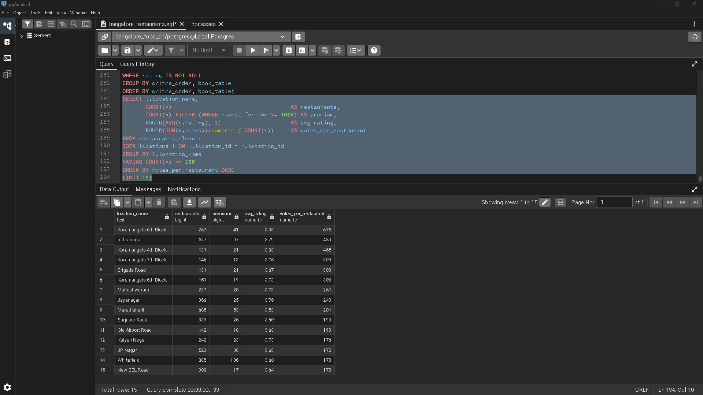

PostgreSQL analysis of 51,717 Zomato Bangalore listings: where should a new restaurant open?

# Where Should a New Restaurant Open in Bangalore?

A SQL analysis of the Zomato Bangalore Restaurants dataset (Kaggle), built in PostgreSQL with pgAdmin 4.

## The question
A new restaurant owner in Bangalore needs to decide **what to open and where**. This project uses restaurant ratings, votes, prices, cuisines and services to find an area and concept with strong demand and room for one more player.

## Answer in one paragraph
Open a **premium (₹1,000+ for two) restaurant with table booking, serving a niche cuisine such as Japanese, Korean or Modern Indian, in Koramangala 5th Block**. It has the highest demand per restaurant in the city (675 votes per restaurant), a 3.93 average rating, and only 8 restaurants serving those niche cuisines. **Indiranagar** is the proven runner-up but is far more crowded. The big suburbs (Whitefield, Marathahalli) have many restaurants but weaker ratings and about a third of the demand per restaurant.

## Data and method
- Source: Zomato Bangalore Restaurants (Kaggle), 51,717 raw rows with 17 columns.
- The raw rows contain 12,499 real restaurants, listed once per category and listing area. I kept one row per restaurant (name and address), choosing the row with the most votes.
- Pipeline (the standard analytics workflow):

| Stage | What I did | Result |
|---|---|---|
| 1. Define | Wrote the business question | Where should a new restaurant open? |
| 2. Ingest | Loaded the CSV untouched into `zomato_raw`, all columns as TEXT | 51,717 rows |
| 3. Profile | Counted, tested duplicates by (name, address) | 12,499 restaurants |
| 4. Clean | `restaurants_clean`: numeric rating, votes, cost; booleans for ordering and booking | 9,481 rated restaurants |
| 5. Model | Split into `locations`, `cuisines`, `restaurant_cuisines` with primary and foreign keys | 93 areas, 106 cuisines, 28,817 links |
| 6. Analyze | Seven queries (below) | Findings below |
| 7. Communicate | This README | |

SQL used: `JOIN`, `GROUP BY`, `HAVING`, `CASE WHEN`, `FILTER`, CTEs, `DISTINCT ON`, window functions, regex cleaning, `unnest` and `string_to_array`, subqueries, and foreign keys.

## Findings

**1. Best-rated areas** (30 or more rated restaurants): Lavelle Road 4.08, Koramangala 5th Block 3.93, St. Marks Road 3.92, Church Street 3.88, Residency Road 3.84. The top areas are all central.

**2. Most crowded areas:** Whitefield (885), Electronic City (730), BTM (728), HSR (705), Marathahalli (685). Crowded is not the same as well-rated.

**3. Cuisine gaps** (20 to 150 restaurants, ranked by rating): Modern Indian 4.27 (22 restaurants), Japanese 4.21 (46), Mediterranean 4.20 (86), Korean 4.17 (23).

**4. Price band vs rating:** Under ₹300: 3.55 · ₹300 to 599: 3.55 · ₹600 to 999: 3.67 · ₹1,000+: 4.03. Higher-priced restaurants rate noticeably better.

**5. Services vs rating:** Table booking is the big separator (about 4.1 with booking against about 3.5 to 3.6 without). Online ordering makes almost no difference.

**6. Demand per restaurant** (votes per restaurant, areas with 100 or more restaurants):
Koramangala 5th Block 675 · Indiranagar 489 · Koramangala 4th Block 465 · Koramangala 7th Block 309 · Brigade Road 303. Whitefield is 170 and Marathahalli 201.

**7. Where the niche cuisines already are** (Japanese, Korean, Modern Indian, Mediterranean): Indiranagar 18, Whitefield 18, Marathahalli 11, HSR 10, Koramangala 5th Block 8.

## Recommendation
1. **Area: Koramangala 5th Block.** Highest votes per restaurant, a 3.93 rating, and only 8 niche-cuisine restaurants against 18 in Indiranagar.
2. **Concept: premium niche cuisine, ₹1,000+ for two.** Premium restaurants average 4.03, and the three niche cuisines rate 4.17 to 4.27.
3. **Offer table booking.** Booking restaurants rate about half a point higher.
4. **Backup: Indiranagar,** a proven premium market but crowded (527 restaurants, 18 niche).
5. **Avoid for this concept: Whitefield and Marathahalli.** Ratings are 3.60 and 3.53, and demand per restaurant is about a third of Koramangala's.

## Limitations
- Votes measure popularity, not revenue. Rent, footfall and competition costs are not in the data.
- Ratings and booking are correlated, not proven causes: good restaurants tend to offer booking.
- The dataset is a one-time snapshot, so the market may have moved on.
- 9,481 of 12,499 restaurants have a rating; unrated ones are excluded from rating averages.

## Repository contents
- `bangalore_restaurants.sql`: all queries, in order
- `Q1.png` to `Q7.png`: result screenshots for each query
